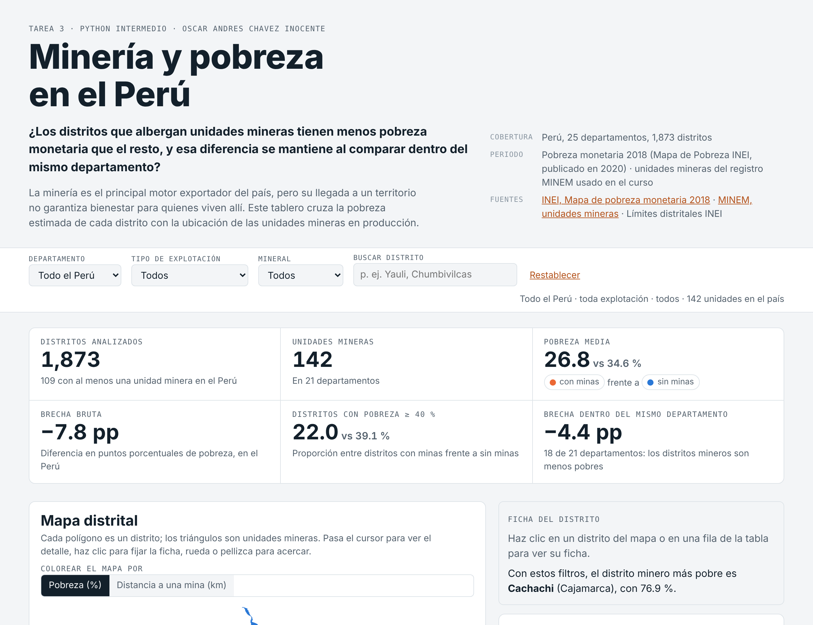
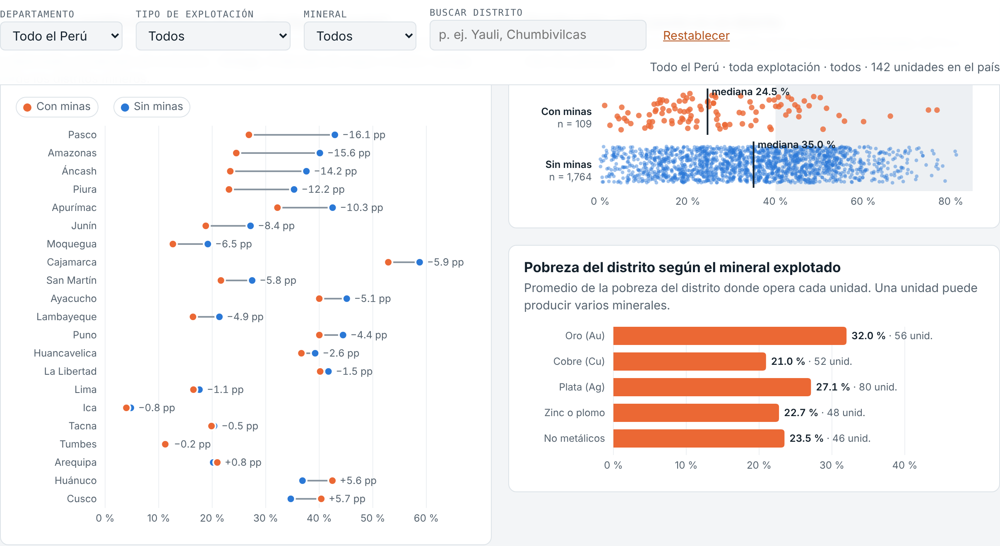
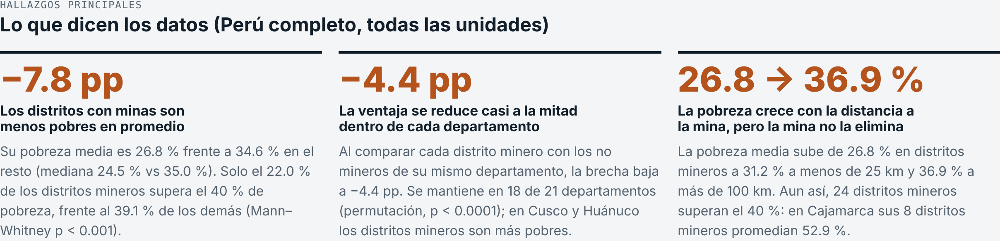

# Minería y pobreza en el Perú: ¿los distritos con minas son menos pobres?

Tarea 3 del curso **Python Intermedio**: *Del dato a la historia: dashboard interactivo y reel con IA*.
Autor: **Oscar Andres Chavez Inocente**.

## Enlaces

| Producto | Enlace |
|---|---|
| Dashboard público | https://o-chavx.github.io/Tarea_3/web/ |
| Publicación de LinkedIn con el reel | *pendiente* |
| Publicación de LinkedIn con capturas del dashboard | *pendiente* |
| Reel (archivo) | [`reel/reel.mp4`](reel/reel.mp4): 51 s, vertical, con voz generada con IA a partir de mi voz |
| Repositorio | https://github.com/O-Chavx/Tarea_3 |

## Tema y pregunta de investigación

**Tema:** minería y pobreza a nivel distrital en el Perú.

**Pregunta:** ¿Los distritos que albergan unidades mineras tienen menos pobreza monetaria que el resto del país, y esa diferencia se mantiene al comparar dentro del mismo departamento?

**Cobertura:** 1,873 distritos de los 25 departamentos; pobreza monetaria 2018 (Mapa de Pobreza del INEI, publicado en 2020); 142 unidades mineras en producción del registro MINEM.

## Descripción

El proyecto cruza la pobreza monetaria que el INEI estimó para cada distrito con la ubicación de las unidades mineras del MINEM.

- Para cada distrito: si alberga minas, cuántas y a qué distancia está la mina más cercana.
- Comparaciones: distritos mineros frente al resto, en todo el país y **dentro de cada departamento**, por banda de distancia, por mineral y por método de explotación.
- Productos:
  - un dashboard público e interactivo;
  - un reel de divulgación con mi voz clonada por IA;
  - dos publicaciones en LinkedIn: una con el reel y otra con capturas del dashboard.

## Estado del proyecto

| Etapa | Estado |
|---|---|
| 1. Obtención, procesamiento, análisis y verificación de datos | ✅ Completa: 32 comprobaciones OK |
| 2. Dashboard público e interactivo | ✅ Publicado en GitHub Pages: 56 pruebas en navegador OK |
| 3. Reel con IA (guion, voz propia clonada, imágenes, música, subtítulos) | ✅ Terminado: 30 comprobaciones OK ([`reel/`](reel/README.md)) |
| 4. Publicación en LinkedIn y README final | ⏳ Textos y capturas listos en [`docs/publicacion/`](docs/publicacion/) |

## Dashboard

[Abrir el dashboard](https://o-chavx.github.io/Tarea_3/web/). Es una página estática en `web/` (HTML, CSS y JavaScript con D3.js), publicada con GitHub Pages.



**Controles.** Una barra de filtros fija arriba actualiza todos los indicadores, el mapa, los gráficos y la tabla:

- **Departamento:** todo el Perú o uno de los 25 (el mapa se acerca a él).
- **Tipo de explotación:** subterránea, superficial, no metálica, refinería o fundición.
- **Mineral:** oro, cobre, plata, zinc o plomo, no metálicos.
- **Buscar distrito:** filtra la tabla por distrito o provincia.
- **Colorear el mapa por:** pobreza o distancia a la mina más cercana.

Además: clic en un distrito (mapa, gráfico o tabla) para ver su ficha, clic en un departamento del gráfico de brechas para filtrarlo, zoom en el mapa y botón **Restablecer**. Al cambiar el filtro de minas, **todo se recalcula en el navegador**: qué distritos son mineros y la distancia de cada distrito a la mina más cercana.

**Seis KPI:** distritos analizados, unidades mineras, pobreza media (con minas frente a sin minas), brecha bruta, porcentaje de distritos con pobreza ≥ 40 % y brecha dentro del mismo departamento (o el distrito minero más pobre, si se elige un departamento).

**Visualizaciones:**

- mapa interactivo de 1,823 distritos con las 142 unidades mineras;
- pobreza según la distancia a una mina;
- brecha dentro de cada departamento (gráfico de mancuernas);
- distribución: un punto por distrito, con medianas;
- pobreza del distrito según el mineral explotado;
- tabla ordenable y con buscador de los 1,873 distritos.

Funciona en celular y en modo oscuro.



**Prueba automática.** `scripts/probar_dashboard.py` abre el dashboard en Chromium sin interfaz y hace **56 comprobaciones, todas OK** (`web/prueba_dashboard.txt`):

- Cambia los filtros en 11 combinaciones de departamento × tipo de explotación × mineral. En cada una compara los KPI y el número de minas del mapa con lo que se calcula en pandas.
- Prueba Restablecer, el buscador, el clic en la tabla, el cambio de variable del mapa, el modo oscuro y la vista de celular.
- Falla ante cualquier error de JavaScript.

## Reel

[`reel/reel.mp4`](reel/reel.mp4) cuenta los tres hallazgos en 51 segundos. El guion, la voz, los subtítulos, la música y el montaje se detallan en [`reel/README.md`](reel/README.md).

| Requisito | Cómo se cumple |
|---|---|
| 45 a 75 s y 5 a 7 escenas | 51.3 s y 6 escenas: gancho, tres hallazgos, matiz (Cajamarca) e invitación al tablero |
| Formato | Vertical 9:16, 1080 × 1920, H.264, 6.7 MB |
| Narración con IA a partir de la voz propia | Qwen3-TTS 1.7B (Apache 2.0) clonó mi voz a partir de una grabación propia de 24.7 s (no se sube a git) |
| Imágenes, gráficos y mapas | Mapa nacional, mapa de Cajamarca, tres gráficos y una captura del dashboard, con acercamiento lento |
| Música | Pista original generada con código (CC0), 15 dB por debajo de la voz |
| Subtítulos | Sincronizados palabra por palabra e incrustados; también en `reel/subtitulos.srt` |
| Fuente, créditos y aviso de IA | «Voz generada con IA a partir de mi voz», «Datos: INEI, Mapa de pobreza 2018 · MINEM» y créditos durante todo el video |

**Verificación.** `scripts/verificar_reel.py` hace **30 comprobaciones, todas OK**:

- cada cifra del guion frente a `resultados.json`;
- formato, duración y sonoridad (−17.2 LUFS);
- música bajo la voz;
- subtítulos frente al guion: Whisper transcribió el audio final con un error de palabras de **0.006**.

## Fuentes de datos y metodología

| Fuente | Enlace | Uso |
|---|---|---|
| INEI (2020), *Mapa de pobreza monetaria provincial y distrital 2018* | [PDF](https://www.inei.gob.pe/media/MenuRecursivo/publicaciones_digitales/Est/Lib1718/Libro.pdf) | Pobreza de los 1,873 distritos |
| MINEM, unidades mineras en producción | [portal MINEM](http://www.minem.gob.pe/_publicaSector.php?idSector=1&idCategoria=24) | 142 unidades: titular, método, minerales, UBIGEO y coordenadas |
| Límites distritales (INEI), GeoJSON simplificado | [repositorio del curso](https://github.com/d2cml-ai/Data-Science-Python/tree/main/sessions/06-geoespacial/lab/Data) | Mapa, centroides y distancias |

Las bases vienen del repositorio del curso (sesión 06). `scripts/obtener_datos.py` las descarga y muestra su SHA-256: Poverty `b54a657567b7`, MINING `19a493f05066` y distrital `1eba0da33464`. Se obtuvieron el 30 de octubre de 2026.

**Metodología.** Un distrito es «minero» si alberga al menos una unidad, según su UBIGEO oficial.

- **Brecha bruta:** pobreza media de los distritos mineros menos la del resto.
- **Brecha dentro del departamento:** la misma resta en cada departamento, promediada según su número de distritos mineros. Así se compara cada distrito minero con sus vecinos y no con todo el país.
- **Distancia:** haversine desde el centroide del distrito a la unidad más cercana. Se calcula sin geopandas, con numpy y `matplotlib.path`.
- **Pruebas:** Mann–Whitney y permutación con 10,000 sorteos dentro de cada departamento.

Las variables, fórmulas y decisiones de limpieza se detallan en [`docs/metodologia.md`](docs/metodologia.md).

**Verificación.** `datos/procesados/verificacion.txt` tiene **32 comprobaciones, todas OK**.

- **Contraste con el INEI:** los tres distritos más pobres son los mismos que publicó el INEI (Uchuraccay, Oxamarca y Anguía). También coinciden los 16 de los 20 más pobres en Cajamarca y los **713 distritos** con pobreza de 40 % o más ([fuente](https://perusupportgroup.org.uk/2020/02/poverty-map-published/)).
- **Cifras propias:** cada número del README, del dashboard y del reel se recalcula desde los CSV.
- **Dashboard:** sus datos son idénticos a los procesados.

## Tres hallazgos principales

Detalle en [`docs/hallazgos.md`](docs/hallazgos.md).

1. **Los distritos con minas son menos pobres en promedio: −7.8 puntos.**
   - Su pobreza media es **26.8 %**, frente a **34.6 %** del resto (mediana 24.5 % frente a 35.0 %).
   - Solo el 22.0 % de los 109 distritos mineros supera el 40 % de pobreza, frente al 39.1 % de los demás (Mann–Whitney, p < 0.001).
2. **Dentro del mismo departamento, la ventaja baja casi a la mitad: −4.4 puntos.**
   - Parte de la brecha se explica por *dónde* están las minas.
   - Aun así, se mantiene en **18 de 21** departamentos y no aparece por azar (permutación, p < 0.0001).
   - En Cusco (+5.7) y Huánuco (+5.6), los distritos mineros son *más* pobres que el resto de su departamento.
3. **La pobreza aumenta con la distancia a una mina, pero la mina no garantiza bienestar.**
   - La pobreza media pasa de 26.8 % en los distritos mineros a 31.2 % a menos de 25 km, y a 36.9 % a más de 100 km.
   - A más de 100 km, el 54.4 % de los distritos supera el 40 %.
   - Pero **24 distritos mineros** superan ese umbral: los 8 de Cajamarca promedian **52.9 %**.



## Limitaciones

- **Asociación, no causalidad.** Las minas no se ubican al azar: los distritos mineros pueden diferir en altitud, urbanización o conectividad. Además, refinerías y fundiciones están en zonas urbanas.
- **Un solo corte (2018).** No permite ver si la pobreza cambió después de que llegó la mina.
- **Promedios simples por distrito**, sin ponderar por población: un distrito de 500 habitantes pesa igual que uno de 500,000.
- **La pobreza distrital es una estimación** en áreas pequeñas con intervalo de confianza. Aquí se usa el punto medio de ese intervalo.
- **Registro minero incompleto.** Incluye 142 unidades formales, sin minería artesanal, informal ni en exploración. En 33 unidades la coordenada cae fuera del distrito declarado: para clasificar se usa el UBIGEO y las coordenadas solo para mapas y distancias.
- **Mapa desactualizado.** El geojson tiene 1,834 polígonos. Los 50 distritos creados después (por ejemplo, Uchuraccay) no tienen polígono ni distancia, pero sí entran en los KPI y en la tabla.

Más detalle en [`docs/metodologia.md`](docs/metodologia.md).

## Cómo reproducir

Se necesita Python 3.10 o superior.

```bash
pip install -r requirements.txt
python scripts/obtener_datos.py      # descarga las bases y muestra su SHA-256
python scripts/procesar_datos.py     # limpieza, cruce, centroides y distancias
python scripts/analizar_datos.py     # indicadores, pruebas, resultados.json y datos del dashboard
python scripts/verificar_datos.py    # 32 comprobaciones -> datos/procesados/verificacion.txt
python scripts/probar_dashboard.py   # 56 pruebas en navegador (playwright install chromium)
python scripts/verificar_reel.py     # 30 comprobaciones del guion y del video
```

El reel va en un entorno aparte, porque `qwen-tts` fija `transformers==4.57.3`. Los pasos están en [`reel/README.md`](reel/README.md). La grabación de referencia no está en el repositorio: hace falta una propia.

**Ver el dashboard en local:** `python -m http.server` en la raíz del repositorio y abrir `http://localhost:8000/web/`.

## Estructura

```
datos/
  originales/   bases del curso: Poverty.csv (INEI), MINING.csv (MINEM), GeoJSON
  procesados/   distritos.csv, minas.csv, departamentos.csv, resultados.json, verificacion.txt
scripts/        obtener, procesar, analizar y verificar los datos; probar el dashboard; verificar el reel
docs/           metodologia.md, hallazgos.md, capturas/ (imágenes del dashboard),
                publicacion/ (textos de LinkedIn, miniatura del reel y comentario de entrega)
web/            dashboard: index.html (HTML, CSS y D3.js) y data/datos.js
index.html      redirige a web/ (raíz del sitio de GitHub Pages)
reel/           guion, imágenes, música, voz con IA, subtítulos y montaje (ver reel/README.md)
```

## Recursos reutilizados

- **Bases de datos y límites distritales:** de la sesión 06 del curso.
- **Flujo del reel:** `reel/reel.py` es el módulo de la sesión 15 del curso, sin cambios. `hacer_reel_mineria.py` lo extiende con imágenes por escena, música y créditos.
- **Tipografía:** Inter (SIL OFL) en el reel; Archivo, Source Sans 3 e IBM Plex Mono (Google Fonts) en el dashboard.

## Uso de inteligencia artificial

Desarrollé este proyecto con **Claude** (Anthropic) como asistente para escribir el código, construir el dashboard, armar el reel, verificar las cifras y redactar la documentación. Elegí el tema y revisé los resultados; soy responsable de ellos.

- **Cifras:** salen de los scripts del repositorio, no del asistente. Su verificación está en `datos/procesados/verificacion.txt`; la del dashboard, en `web/prueba_dashboard.txt`; y la del reel, en `reel/verificacion_reel.txt`.
- **Voz del reel:** la generó Qwen3-TTS 1.7B (Alibaba, Apache 2.0) a partir de mi propia voz. Whisper (OpenAI, MIT) transcribió la referencia y controló la pronunciación.
- **Música:** original, generada con código (CC0).
- **Textos de LinkedIn:** el asistente los propuso; yo los reviso y los publico.
