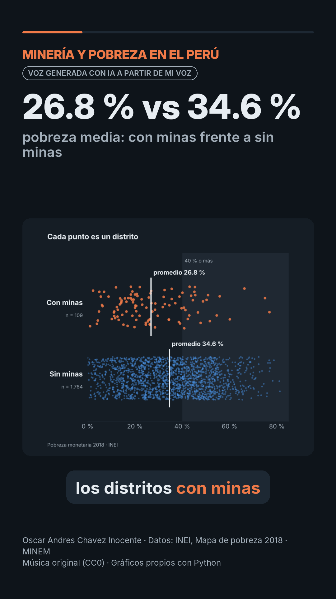

# Reel: Minería y pobreza en el Perú

`reel.mp4`: 51.3 s, vertical 1080 × 1920, H.264 + AAC, 6.7 MB, narrado con mi voz clonada por IA.



## Guion (6 escenas)

| # | Función | Narración | En pantalla | Imagen |
|---|---|---|---|---|
| 1 | Gancho | ¿Vivir cerca de una mina te hace menos pobre? Crucé la pobreza de 1,873 distritos con 142 unidades mineras. | **1,873** | Mapa nacional de pobreza con las minas |
| 2 | Hallazgo 1 | En promedio, los distritos con minas tienen 26.8 % de pobreza; el resto, 34.6 %. | **26.8 % vs 34.6 %** | Distribución: cada punto es un distrito |
| 3 | Hallazgo 2 | Dentro del mismo departamento la brecha baja de 7.8 a 4.4 puntos. | **−4.4 pp** | Brecha por departamento |
| 4 | Hallazgo 3 | La pobreza sube al alejarse: 31 % a < 25 km, casi 37 % a > 100 km. | **31 % → 37 %** | Barras por distancia |
| 5 | Matiz | 24 distritos mineros superan el 40 %; en Cajamarca promedian casi 53 %. | **24** | Mapa de Cajamarca |
| 6 | Cierre | Es una asociación, no una prueba de causa. Explora el tablero. | Invitación | Captura del dashboard |

El texto exacto está en `guion.json` (números en palabras para la voz y en cifras para la pantalla). `scripts/verificar_reel.py` comprueba cada cifra contra `resultados.json`.

## Cómo se hizo

| Paso | Herramienta | Archivo |
|---|---|---|
| Imágenes de cada escena | matplotlib (datos procesados) + captura del dashboard | `generar_visuales.py` → `recursos/escena*.png` |
| Grabación de referencia | Nota de voz propia (31 s, acelerada a 24.7 s sin cambiar el tono) | no se sube al repositorio |
| Narración | **Qwen3-TTS 1.7B** (Alibaba, Apache 2.0) clona la voz; ritmo final ×1.05 | `hacer_reel_mineria.py` + `reel.py` (sesión 15) |
| Control de pronunciación | **Whisper large-v3-turbo** (MIT) transcribe cada escena; si el error de palabras supera 0.25 se regenera | WER por escena en `guion.json` |
| Subtítulos | Whisper con marcas de tiempo por palabra; bloques de 4 palabras con la palabra actual resaltada | `subtitulos.srt` |
| Música | Pista original generada con numpy (La m – Fa – Do – Sol), **CC0** | `recursos/generar_musica.py` → `recursos/musica_fondo.wav` |
| Montaje | Pillow (cuadros) + ffmpeg (H.264, voz normalizada, música −20 dB con fundidos) | `hacer_reel_mineria.py` |

## Requisitos de la rúbrica

| Requisito | Cómo se cumple |
|---|---|
| 45 a 75 s, 5 a 7 escenas | 51.3 s y 6 escenas: gancho, tres hallazgos, matiz y cierre |
| Formato vertical | 1080 × 1920, 9:16 |
| Narración con IA a partir de la voz propia | Qwen3-TTS 1.7B clonó mi voz desde una grabación propia |
| Imágenes, gráficos y mapas | 2 mapas, 3 gráficos y una captura del dashboard, con un acercamiento lento en cada escena |
| Música bajo la voz | Música sola a −32 dB en las pausas frente a −17 dB de la mezcla (15 dB por debajo) |
| Subtítulos sincronizados | Incrustados palabra por palabra y en `subtitulos.srt` |
| Aviso de IA, fuente y créditos | «Voz generada con IA a partir de mi voz», «Datos: INEI, Mapa de pobreza 2018 · MINEM» y créditos de música y gráficos, durante todo el video |

## Verificación

`python scripts/verificar_reel.py` → `verificacion_reel.txt`: **30 comprobaciones, todas OK**: cifras del guion, formato, duración, sonoridad (−17.2 LUFS), música bajo la voz y subtítulos frente al guion (**WER 0.006**: Whisper oyó el audio final igual que el guion salvo «Explore» por «Explora»).

## Versiones

- `reel.mp4`: versión final (Qwen3-TTS 1.7B, segunda grabación).
- `reel_v1.mp4`: primera prueba (Qwen3-TTS 0.6B, 59.4 s). Se descartó porque la voz sonaba más plana y lenta.

## Reproducir

```bash
cd reel
uv venv .venv
uv pip install --python .venv/bin/python qwen-tts faster-whisper imageio-ffmpeg soundfile jiwer num2words pillow numpy matplotlib pandas
.venv/bin/python generar_visuales.py
.venv/bin/python recursos/generar_musica.py
.venv/bin/python hacer_reel_mineria.py --vista-previa                     # sin voz, para revisar diseño
.venv/bin/python hacer_reel_mineria.py --voz mi_voz.ogg --tts Qwen/Qwen3-TTS-12Hz-1.7B-Base --velocidad 1.05
```

En Windows: `.venv\Scripts\python`. Hace falta una grabación propia de 15 a 25 s.
